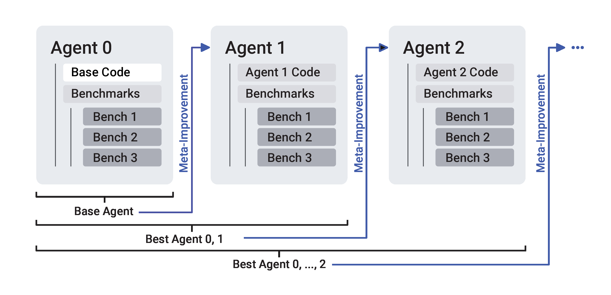
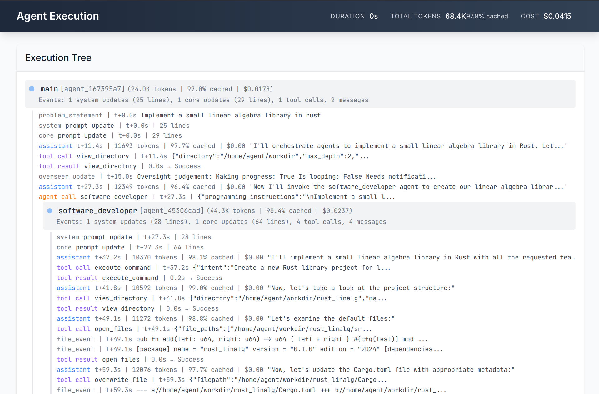

<p align="center">
  <h1 align="center">Self-Improving Coding Agent</h1>
  <p align="center">A coding agent experiment, that works on its own codebase.</p>
  <p align="center">
    
  </p>
</p>

The system operates as an iterative improvement loop:
1. evaluating the current agent version on some benchmark tasks to capture how well it does
2. storing the results in an archive
3. running the agent on its own codebase to work on an improvement
4. going back to step 1 with the updated agent code

See [our workshop paper](https://openreview.net/pdf?id=rShJCyLsOr) for more details.

## Quickstart

> IMPORTANT NOTE: always run the agent in the provided Docker container. Since the agent can execute shell commands, this offers some isolation from your host machine, avoiding inadvertent file system manipulation and similar risks.

First, make sure you've cloned the repo
```bash
git clone https://github.com/MaximeRobeyns/self_improving_coding_agent
```

Then, export some environment variables in the shell from which you run the
agent. They are handed to each docker container when it is started, and are
not stored in the docker image. The project supports inference from a number of providers to
allow for experimentation across many models. You must export at least one of
these in your _local_ shell, which you can do either directly or with `direnv`,
`dotenv`, etc. Omitting any provider key will simply make that provider's
models unavailable to the agent.

```bash
export ANTHROPIC_API_KEY=  # For Claude models
export OPENAI_API_KEY=  # For GPT 4o and reasoning models (o1, o3, etc)
export GEMINI_API_KEY=  # For Gemini models
export VERTEX_PROJECT_ID=  # For models hosted on GCP's Vertex
export FIREWORKS_AI_API_KEY=  # For DeepSeek / Llama hosted on fireworks
export DEEPSEEK_API_KEY=  # For DeepSeek direct inference (V3, R1)
export MODAL_TOKEN_ID=  # To allow the agent to visit webpages and read papers
export MODAL_TOKEN_SECRET=  # To allow the agent to visit webpages and read papers
```
For gemini, you should replace the template file in `sandbox/GOOGLE_APPLICATION_CREDENTIALS.json` with your own credentials. This file is mounted into the containers read-only; it is not copied into the image either.

> If you built the image with an earlier version of this repository, your API keys are stored in it. Rebuild it, and remove the old images (`docker image ls sica_sandbox`, then `docker image rm <id>`), before sharing or pushing an image anywhere.

Next, build the docker image. The build command is wrapped in a Makefile target for convenience:

```bash
make image
```

If you are using an apple silicon machine, use this target instead:
```
make image-mac
```

Finally, install the requirements in your local python environment:
```bash
# remember to activate a virtual environment or equivalent here
pip install -r base_agent/requirements.txt
```
The `swebench` benchmark additionally needs the SWE-bench harness installed from source (`scripts/install_swebench_harness.sh`); nothing else does.

### Testing the Agent

To test if the setup was successful, you can run the agent interactively with a manually set initial prompt using this target
```bash
make int
```
This will start the docker container and attach your shell to it. You can then run
```bash
python -m agent_code.agent --server true -p "<some initial request here>"
```
Then open your browser on http://localhost:8080 to follow the agent execution. This will show you an interactive webpage which visualises the events in the event bus / the agent callgraph, allowing you to click on individual events to see them in more detail, read overseer messages, and collapse sub-agent traces.



The agent's working directory is mapped to `results/interactive_output` and any files created will be available here on your machine. Agent logs will be in `results/interactive_output/agent_output`.

You can see more options by doing
```bash
make help
```
or agent arguments wit
```bash
python -m base_agent.agent --help
```

To further configure the agent, including the choice of LLMs, edit `base_agent/src/config.py`, or set `AGENT_MODEL`, `AGENT_REASONING_MODEL` and `AGENT_OVERSIGHT_MODEL` to the name of a model in `base_agent/src/types/llm_types.py`. The default model is Claude Sonnet 5.5 (`SONNET_55`); `OPUS_55` and `HAIKU_55` are defined as well. The Claude 3.x models that the agent was originally written for have been retired from the Claude API.

### Tests

```bash
make test    # the agent's tests (base_agent/tests) and the runner's (tests/)
ruff check . # what CI lints for: syntax errors and undefined names
```
Neither test suite calls a model or starts a container.

## Self-Improvement Loop

To run the self-improvement loop, do
```bash
python runner.py
```
This runs the `gsm8k` benchmark. To run others, name them (`python runner.py --help` lists those available, which are defined in `base_agent/src/benchmarks/__init__.py`):
```bash
python runner.py --benchmarks gsm8k humaneval file_editing
```
To see all the options, do
```bash
python runner.py --help
```
Common options might be
```bash
python runner.py --id 1 --workers 6
```

This will start the agent loop, placing the results in `results/run_<id>`.

Instead of a long command line, settings can be kept in a YAML file. `run.example.yaml` lists all of them with their defaults; options given on the command line take precedence over the file.
```bash
python runner.py --config run.example.yaml --children 2
```

By default each new agent is built from the latest agent that is not significantly worse than the best one (`greedy_ci`). Two sampling strategies are also available, which spread the search over more of the archive:
```bash
python runner.py --selection score_child_prop --seed 1  # favour high scores and agents with few children
python runner.py --selection thompson --seed 1          # Thompson sampling over each agent's success rate
```
The parent, strategy, seed and selection probabilities of every agent are recorded in `results/run_<id>/agent_<i>/lineage.json`.

To branch the search out, create several new agents per iteration, each from its own selected parent. They are created in parallel and then evaluated one after the other:
```bash
python runner.py --selection score_child_prop --children 3
```
By default the best-scoring agent carries out each improvement. `--meta-agent` changes that (`parent`: each new agent's own parent; `seed`: the initial agent; or a fixed agent id), and `--meta-model` makes it use another model for the improvement only, e.g. a stronger model building the scaffold that a weaker one is benchmarked with:
```bash
python runner.py --meta-agent seed --meta-model SONNET_37
```

Before a new agent is evaluated it has to pass a validation gate, run in its own sandbox: its code imports, its unit tests pass (unless its parent's did not either), and it solves a trivial problem end to end. An agent that does not is marked `invalid`, and is neither evaluated nor built upon. The initial agent is checked once when a run starts, so that a broken setup is noticed before anything is spent.
```bash
python runner.py --gate-retries 1         # let the meta agent try to fix an agent that fails the gate
python runner.py --gate-checks import     # only some of the checks (import, tests, smoke)
python runner.py --gate-checks none       # no gate
```

Scores on a handful of problems are noisy, and three options make the evaluation more trustworthy or cheaper:
```bash
python runner.py --repeats 3            # run every problem 3 times and average
python runner.py --holdout-fraction 0.3 # keep 30% of the problems out of the archive the agents see
python runner.py --stage1-size 8        # try new agents on 8 problems per benchmark first
```
- With `--holdout-fraction`, results on the held-out problems go to `results/holdout/run_<id>/` (same layout as the experiment directory). Agents never see them, so a gain that shows up on the archive problems but not on the held-out ones is overfitting. The split can only be chosen when an experiment is started.
- With `--stage1-size`, an agent that is clearly worse than its parent on the first-stage problems is not evaluated further and not built upon (`--promote-threshold` sets how much worse is tolerated).

Each problem has a time and a cost limit (`--timeout-s`, default 600; `--cost-limit-usd`, default 3), and `--subset-size` sets how many problems are taken from each benchmark (default 18; 0 for all).

These settings are stored with the experiment and kept when it is resumed. The choice of problems (`--subset-size`, `--benchmark-seed`, `--holdout-fraction`) cannot be changed once agents have been evaluated.

To see how an experiment went (the tree of agents, progress and cost per generation, archive vs held-out scores, and how parents were selected), or how much several experiments differ from run to run:
```bash
python -m search.report results/run_1
python -m search.report results/run_1 results/run_2 results/run_3
```

An interrupted run can be resumed with `--id <id>`: it continues with the agents that were planned, and moves the remains of any half-made agent to `results/run_<id>/_interrupted/`.

## Things to work on

Here are some potential things to try and do with the agent framework:

- [ ] get the agent to curate / build more of its own benchmarks
- [ ] reduce the variance of self-improvement runs (early features often influence subsequent features)
- [ ] use a stronger LLM to build a scaffold for a weaker LLM
- [ ] find or create more realistic 'software engineering' benchmark tasks

## Agent Description

The agent in `base_agent` is a minimal agent that can just about perform the
meta-improvement task. It lacks efficient file editing tools, devtools such as
tree sitter or LSP integrations, or advanced reasoning structures that would
help it out when performing coding tasks. It has the necessary building blocks
to bootstrap these features and specialise itself to the distribution of
benchmark tasks included.

Please see `base_agent/README.md` for a more detailed discussion of the base agent framework.

```
├── base_agent
│   ├── agent_change_log.md
│   ├── agent.py
│   ├── conftest.py
│   ├── description.txt
│   ├── __main__.py
│   ├── pytest.ini
│   ├── README.md
│   ├── requirements.txt
│   ├── src
│   │   ├── agents
│   │   ├── benchmarks
│   │   ├── callgraph
│   │   ├── config.py
│   │   ├── events
│   │   ├── __init__.py
│   │   ├── llm
│   │   ├── oversight
│   │   ├── schemas
│   │   ├── tools
│   │   ├── types
│   │   ├── utils
│   │   └── web_server
│   └── tests
│       ├── agents
│       ├── benchmarks
│       ├── events
│       ├── __pycache__
│       ├── test_example.py
│       ├── tools
│       └── utils
├── benchmark_data
├── results
│   ├── run_<id>
│   └── interactive_output
├── orchestrator          # the runner: evaluation, agent creation, the loop
├── search                # parent selection, evaluation design, validation gate, reports
├── runner.py             # entry point
├── runner_config.py      # runner settings
├── tests                 # tests of the runner
└── sandbox
```

### Results Organization

```
results/run_{id}/
├── metadata.json          # Experiment metadata
└── agent_{i}/             # Agent iteration directory
    ├── agent_code/        # Agent implementation
    ├── benchmarks/        # Benchmark results
    │   └── {bench_name}/
    │       ├── results.jsonl  # Per-problem results
    │       ├── perf.jsonl     # Summary metrics
    │       └── traces/        # Detailed traces
    ├── lineage.json           # Parent, meta agent, status and how the parent was selected
    └── meta_improvement_logs/ # Logs of the meta-improvement step that created this agent
```

## Citation

```
@inproceedings{
    robeyns2025sica,
    title={{SICA} A Self-Improving Coding Agent},
    author={Maxime Robeyns, Martin Szummer, and Laurence Aitchison},
    booktitle={ICLR 2025 Workshop on Scaling Self-Improving Foundation Models},
    year={2025},
    url={https://openreview.net/forum?id=rShJCyLsOr}
}
```
